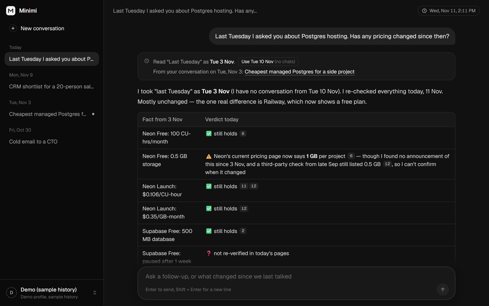
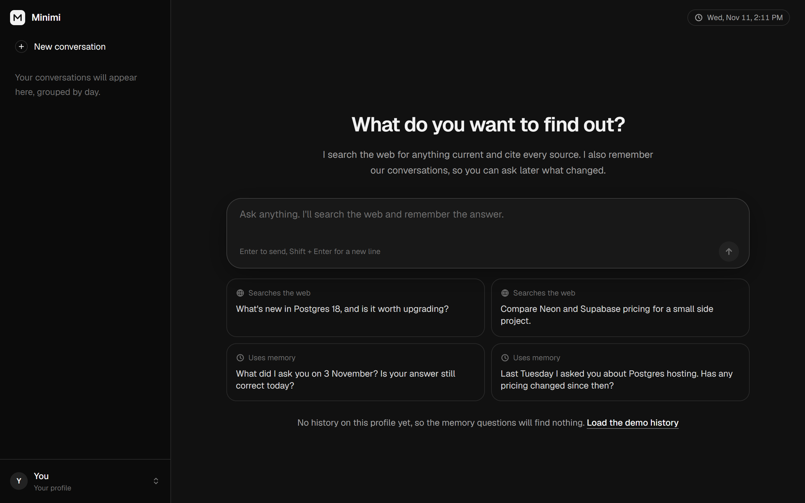
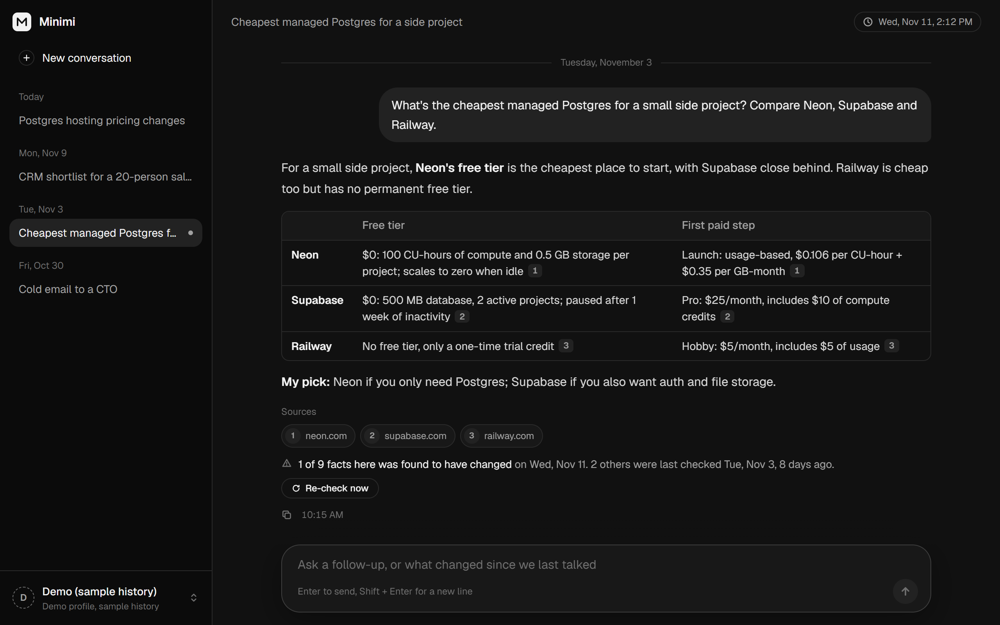
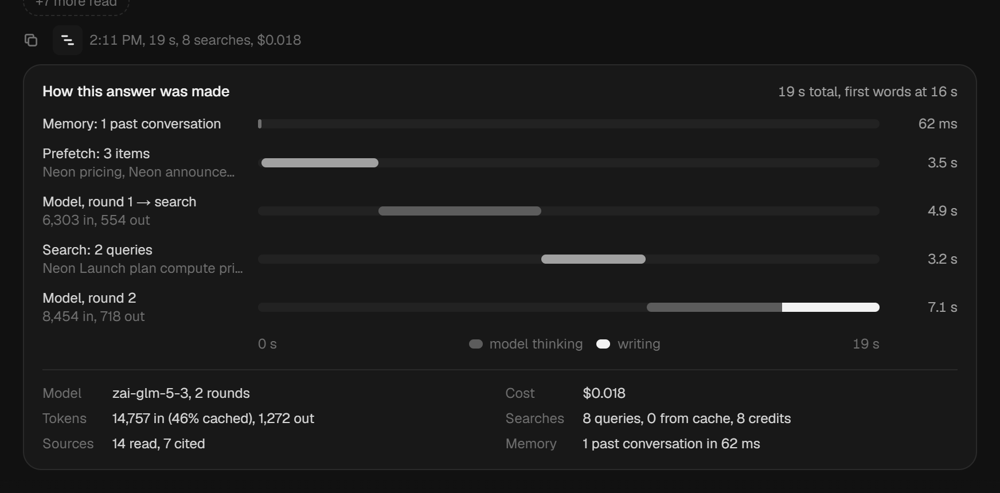
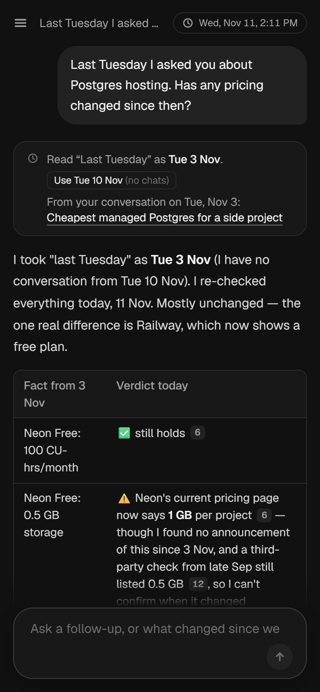

# Minimi

A chat agent with one tool, web search, that remembers your past conversations and knows what day it is. Ask *"What did I ask you on 3 November? Is it still correct?"* and it finds that conversation, re-checks each fact on the web, and tells you what changed.

Next.js + TypeScript on Node. Mistral for the model, Tavily for search, SQLite for memory. How it works and why: [DESIGN.md](DESIGN.md).



## Run it

Requires Node 22.13+ (tested on 24.13).

```bash
npm install
cp .env.example .env    # add MISTRAL_API_KEY and TAVILY_API_KEY
npm run dev             # http://localhost:3000
```

Both keys are free to get: [Mistral](https://console.mistral.ai), [Tavily](https://app.tavily.com) (1,000 credits/month, no card). Everything else in `.env.example` has a working default. The database and a cookie-signing secret are created in `./data` on first run.

## Try it



A new profile has no history, so the memory questions find nothing. That is the correct answer, and Minimi says so instead of inventing one. To see memory at work, click **Load the demo history** on the empty screen (or use the profile menu). This creates a demo profile with past conversations dated relative to today:

| When | Conversation |
|---|---|
| Last Tuesday | Cheapest managed Postgres (Neon, Supabase, Railway) |
| Last Monday | CRM shortlist for a 20-person sales team |
| 3 November | Does Supabase pause free projects? (only when 3 November isn't already last Tuesday) |
| 4 days before last Tuesday | Cold email to a CTO (unrelated) |

Then ask the challenge questions:

- *Last Tuesday I asked you about Postgres hosting. Has any pricing changed since then?*
- *On Monday we shortlisted 5 CRM tools for a 20-person sales team. Has any of them changed pricing or shipped something big since?*
- *What did I ask you on 3 November? Is your answer still correct today?*

What to look for:

- **Date chip** above the answer: how "last Tuesday" was read, with one click to switch to the other reading.
- **Per-fact verdicts**: ✅ still holds, ⚠️ changed (old → new, cited), ❓ couldn't verify.
- **Freshness line** under old answers ("Prices last checked Tue 3 Nov, 8 days ago") and a **Re-check now** button. A dot in the sidebar marks conversations that need one.
- **Timeline button** under each answer: memory, prefetch, model rounds and searches on one time axis, with tokens and cost.
- **Profiles**: each profile has its own memory. Switch or add one from the menu at the bottom of the sidebar.

| Freshness and Re-check | Timeline of one answer |
|---|---|
|  |  |



To pin the clock for a demo, set `AGENT_NOW=2026-11-11T10:00:00+05:30` in `.env`.

## Configuration

| Variable | Default | |
|---|---|---|
| `MISTRAL_API_KEY` | required | |
| `TAVILY_API_KEY` | required | |
| `AGENT_MODEL` | `zai-glm-5-3` | Main chat model |
| `AGENT_BACKGROUND_MODEL` | `mistral-small-2603` | Writes the fact ledger after each answer |
| `SPEND_LIMIT_USD` | `4` | Stops answering past this total model spend (0 = no limit) |
| `SEARCH_MODE` | `live` | `record` saves responses, `replay` uses saved ones (0 credits) |
| `PREFETCH` | `on` | Start searches for remembered items before the model's first call |
| `AGENT_NOW` | empty | Fixed clock for demos |
| `DATABASE_PATH` | `./data/agent.db` | |

## Scripts

| | |
|---|---|
| `npm run dev` / `build` / `start` | App |
| `npm test` | 187 unit tests, no network |
| `npm run typecheck` | TypeScript |
| `npm run seed` | Load the demo history from the command line |
| `npm run eval` | Scenario evals with ablations ([results](evals/results/full-run-2026-11-11.md)). Real model, replayed search: about $0.40 per full run and 0 search credits. `--arms C+`, `--only mem-3nov` and `--no-judge` make it cheaper. |

## Layout

```
src/
  agent/     chat turn, orchestrator, model⇄tool loop, prompts, fact-ledger writer
  context/   date resolver, intent cues, memory recall, prefetch plan, freshness
  search/    Tavily client, ranking, cache, page reader, record/replay
  memory/    SQLite schema, migrations, user-scoped repository, demo seed
  identity/  signed device/profile cookies
  llm/       Mistral streaming client, pricing, fake model for tests
  app/ ui/   Next.js routes and the chat interface
evals/       scenarios, checks, LLM judge, recorded search fixtures
```
